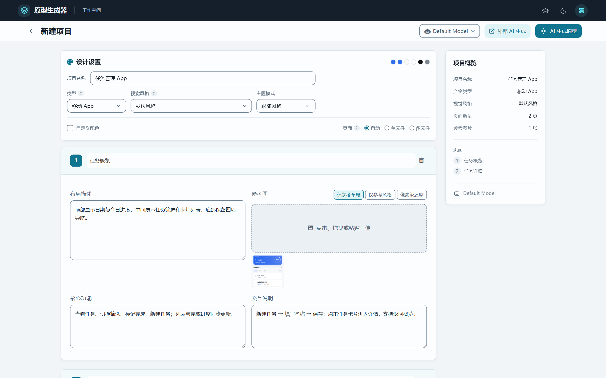
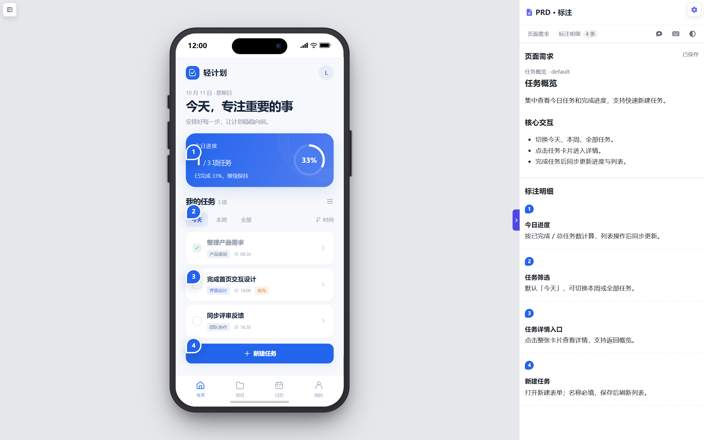
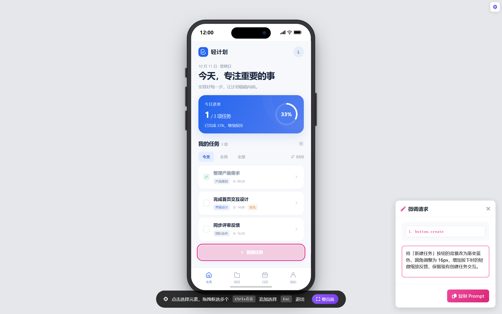
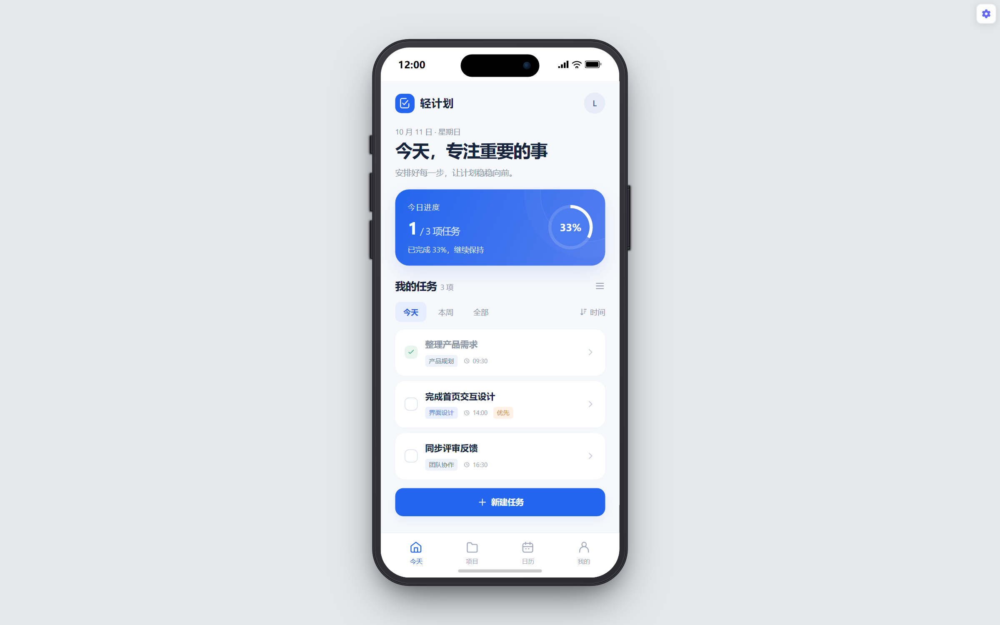

# 🎨 原型生成器 (Prototype Generator)

> 把页面需求、参考图和提示词组织成资料包，交给本地 Agent 制作原型，再接入工作台完成 PRD 标注与交付。


## 为什么做原型生成器

最初做这个工具，就是想在原型阶段，把给 AI 的提示词和参考资料组织得更清楚一点。

项目稍微大一点，往往就会有很多页面、截图、参考图，以及每张图对应的说明。这些内容全部塞进一个对话框，跟 Codex、Claude Code 等 Agent 沟通时，容易说不清楚：这张图参考什么？对应哪个页面？哪些地方需要改？

所以，我希望有一个工具，能把页面结构、图片、需求说明和视觉要求放在一起，形成一份有结构的资料包。给 Agent 的上下文更完整，制作和后续调整原型时，也更容易对齐需求。

**本次更新的重心，是围绕本地 Agent 来完善这套流程。** 第三方 API 直接生成原型的功能仍然保留，但项目接下来会更多聚焦于 Codex、Claude Code 等工具的协作，让资料组织、原型制作和评审交付衔接起来。

实际用起来，可以分成两步：

1. **组织资料，交给 Agent 制作。** 在原型生成器里整理页面需求、参考图和设计设置，复制完整 Prompt，或导出 AI IDE 项目包，交给本地 Agent。你也可以直接在 Agent 工具里完成原型制作，再把项目添加到这里。
2. **接入原型，整理 PRD 和标注。** 安装仓库提供的 [prototype-flow 协作 skill](docs/agent-skill.md)，让 Agent 按项目的接入与 PRD 导入约定整理草稿，再通过项目提供的导入工具落库。页面需求和对应元素的标注，就能在工作台里统一查看、修改和交付。具体格式见 [PRD 草稿导入说明](docs/features.md#prd-草稿落库-proto_importpy2026-09-30)。

我也希望原型做完之后，需求说明能一起留下来。这里的 PRD 和序号标注都支持 Markdown，可以继续补充文字、表格和图片；整理好的内容还能随研发版一起导出，或发布到 GitHub Pages，方便大家评审和沟通。

欢迎大家试试看，也欢迎分享自己的使用方式和建议。

## 界面预览

以下截图使用演示任务数据，展示从需求组织到原型评审的主要界面。

### 1. 新建项目

按页面整理布局、功能、交互说明和参考图，形成供本地 Agent 使用的结构化资料。



### 2. 原型 PRD 标注

将页面需求与元素序号关联，使用 Markdown 编写、查看和维护 PRD。



### 3. 原型微调

点选原型元素，描述修改要求并复制 Prompt，交给本地 Agent 继续调整。



### 4. 手机外壳预览

在手机外壳中体验原型交互，支持切换 App / Web 视图及显示、隐藏外壳。



## ✨ 功能特性

- 🗂️ **统一项目库** - 全屏管理本地 / AI 项目，支持名称与路径搜索、状态筛选、最新创建优先、真实项目封面和浅深主题
- 🚀 **本地 Agent 协作** - 组织页面需求与参考图，复制完整 Prompt 或导出 AI IDE 项目包，交给 Codex、Claude Code 等本地 Agent 制作
- 🖼️ **参考图驱动** - 支持上传参考图，AI 会模仿布局和风格
- 🤖 **内置 AI 生成（可选）** - 配置模型 API 后，输入设计需求生成 HTML 原型
- 🎞️ **HTML PPT 生成** - 支持导入 PPTX 美化或逐页描述生成，产物自带概览和全屏播放模式
- 🎨 **视觉风格与自定义** - 内置 138 份视觉风格，主题支持跟随风格 / 浅色 / 深色；可按需覆盖主色、辅色，生效配色实时同步
- 📋 **剪切板粘贴** - 直接 Ctrl+V 粘贴截图作为参考图
- 🔄 **异步生成** - 点击生成后立即在列表显示，后台完成后自动更新
- 🔀 **多模型切换** - 创建页模型选择器与顶栏模型管理，支持添加/编辑/删除多个 AI 模型配置
- 📝 **统一预览 / 微调 / 标注** - 本地与 AI 项目使用同一工作台，支持页面与状态导航、元素点选、修改任务 Prompt 和 PRD 联动
- 📱 **真机外壳预览** - App 原型支持开关真机外壳，切换保留输入和业务状态；Web 视图自动隐藏外壳选项
- 📄 **所见即所得 PRD** - 页面需求与序号标注支持 Markdown、表格、文字颜色和自动保存；图片支持上传 / 粘贴 / 拖放、等比拖拽缩放与撤销
- 🔢 **可定制序号标注** - 支持序号配色、锚点重新绑定、隐藏标注引导和需求定位；编辑工具条放在编辑框外侧，可拖动和归位
- 🟠 **真实交互热区提示** - 点击原型空白处时，以短暂的透明橙色呼吸提示真实可操作区域，排除无事件的静态按钮
- 👥 **团队协作** - 支持账号登录、创建/加入团队、邀请码邀请成员，并将个人项目分享给团队查看
- ☁️ **GitHub Pages 发布** - 本地与 AI 共用发布入口，提供纯净版和研发版；研发版包含 PRD、图片、彩色序号与页面 / 状态导航
- 📦 **独立交付包** - 本地下载与 Pages 发布采用同一版本选择，纯净版保留原型资源，研发版提供可离线打开的评审壳

## 本次更新：2026.10 工作台升级

这次更新更聚焦本地 Agent 协作，围绕「结构化资料 → Agent 制作 → 接入评审 → PRD 标注 → 发布交付」完善工作流：全新的项目库首页、本地与 AI 统一工作台、可插图与拖拽缩放的 PRD 编辑器，以及统一的纯净 / 研发交付路径。

完整功能亮点、升级步骤与验证范围见 [本次更新说明](docs/releases/2026-10-11.md)，逐次变更见 [更新日志](docs/changelog.md)。

首页样式与图标本地加载，无需访问 Tailwind CDN 或字体服务。修改首页工具类后，开发环境安装 Playwright 并运行 `python tools/build_home_css.py` 重新生成 `src/vendor/home-utilities.css`；日常启动服务无需构建。工具类使用 Tailwind CSS 3.4.17，图标使用 Font Awesome Free 6.4.0，新界面语义样式在 `src/home.css`，设计约定见 `DESIGN.md`。

## 📋 系统要求

- **操作系统**: Windows 10/11, macOS, Linux
- **Python**: 3.10 或更高版本，推荐 3.11+
- **浏览器**: Chrome, Edge, Firefox (推荐 Chrome)
- **网络**: AI 生成与 GitHub Pages 发布需要对应服务可用；本地项目管理与 PRD 编辑可在本机使用

## 🚀 快速开始

### 1. 安装 Python

#### Windows
1. 访问 [Python 官网](https://www.python.org/downloads/)
2. 下载 Python 3.10+ 安装包
3. 运行安装程序，**务必勾选 "Add Python to PATH"**
4. 打开命令提示符，验证安装：
   ```bash
   python --version
   ```

#### macOS
```bash
# 使用 Homebrew
brew install python@3.11
```

#### Linux (Ubuntu/Debian)
```bash
sudo apt update
sudo apt install python3 python3-pip
```

---

### 2. 下载项目

```bash
git clone https://github.com/VampireQW/prototype-generator.git
cd prototype-generator
```

或直接下载 ZIP 并解压。

---

### 3. 安装依赖

```bash
python -m pip install -r requirements.txt
```

首页真实项目封面是可选能力。如需启用：

```bash
python -m pip install -r requirements-preview.txt
python -m playwright install chromium
```

未安装可选依赖或某个原型无法离线渲染时，项目卡片使用名称封面，预览、标注和导出继续可用。首次封面生成在后台排队，后续复用本机缓存。

---

### 4. 启动项目

#### Windows
双击 `启动项目.bat`

更新后端后直接再次双击即可：新实例会自动通知同目录、同端口的旧实例退出，再启动新服务。正在保存或生成时先等待完成，最长约 5 分半，超时保留旧任务；不会按端口强杀其他程序。旧服务正常退出后，启动脚本不再停在“按任意键继续”。

#### macOS/Linux
```bash
python server.py
```

Windows 启动脚本在新服务启动成功后自动打开首页，使用 `config.json` 中配置的端口（默认 `http://localhost:8080/src/index.html`）。直接运行 Python 时可附加 `--open-browser` 自动打开浏览器。

---

### 5. 登录与团队协作

项目支持个人模式和团队协作模式：

1. 打开 `http://localhost:8080/src/login.html`
2. 注册或登录账号
3. 在右上角用户菜单中创建团队，或通过邀请码加入团队
4. 在「我的项目」中点击分享按钮，将项目分享给指定团队
5. 切换到「团队项目」即可查看团队成员共享的原型

> 首次启用团队协作时，会自动在 `data/collab.db` 初始化 SQLite 数据库。已有本地项目可通过 `python migrate.py <username>` 分配给指定账号。

---

### 6. 配置 AI 模型

启动项目后，直接在界面中完成模型配置，**无需手动编辑任何文件**：

1. 点击页面顶栏的 **模型选择器**
2. 点击 **「管理模型」** 按钮
3. 点击 **「添加模型」**，填写以下信息：
   - **模型名称**：自定义名称（如 "GPT-4o"）
   - **服务商**：选择或输入服务商名称
   - **模型标识**：填写模型 ID（如 `gpt-4o`）
   - **API 地址**：填写 base_url（参见下方服务商列表）
   - **API Key**：填写你的密钥
4. 保存后即可在顶栏下拉框中选择使用

> 💡 支持配置多个模型，随时在界面中切换、编辑或删除。

---

## 🔑 支持的 API 服务

本项目支持任何 **OpenAI 兼容** 的 API 服务。在界面的「管理模型」中填写对应的 API 地址和密钥即可。

### 服务商参考

| 服务商 | API 地址 (base_url) | 获取 API Key |
|--------|---------------------|--------------|
| OpenAI | `https://api.openai.com/v1` | [platform.openai.com](https://platform.openai.com/api-keys) |
| Claude | `https://api.anthropic.com/v1` | [console.anthropic.com](https://console.anthropic.com/) |
| Google Gemini | `https://generativelanguage.googleapis.com/v1beta` | [ai.google.dev](https://ai.google.dev/) |
| 通义千问 | `https://dashscope.aliyuncs.com/compatible-mode/v1` | [阿里云控制台](https://dashscope.console.aliyun.com/) |
| 豆包 | `https://ark.cn-beijing.volces.com/api/v3` | [火山引擎控制台](https://console.volcengine.com/ark) |
| Kimi | `https://api.moonshot.cn/v1` | [platform.moonshot.cn](https://platform.moonshot.cn/) |
| 中转服务 | 按服务商提供的 URL | 按服务商说明 |

### 推荐模型

| 厂商 | 推荐模型 | 说明 |
|------|----------|------|
| OpenAI | `gpt-5.2`, `gpt-5.3-codex` | 最强综合能力，5.3-codex 专精代码 |
| Anthropic | `claude-opus-4.6`, `claude-sonnet-4.5` | Opus 旗舰推理，Sonnet 性价比高 |
| Google | `gemini-3-pro`, `gemini-3-flash` | 多模态最强，Flash 速度极快 |
| 字节豆包 | `doubao-2.0-pro`, `doubao-2.0-lite` | 万亿参数，多模态能力强 |
| 阿里千问 | `qwen3-max`, `qwen3-vl-max` | 旗舰推理模型，VL 多模态优秀 |
| Moonshot | `kimi-k2.5`, `kimi-k2.5-vision` | 原生多模态，视觉编程能力强 |

---

## 📁 目录结构

```
原型生成器/
├── server.py              # 后端服务 (Python)
├── db.py                  # 团队协作数据库层 (SQLite)
├── migrate.py             # 旧项目归属迁移脚本
├── proto_meta.py          # 本地项目、页面 / 状态与标注元数据
├── proto_import.py        # PRD 草稿校验与导入
├── review_export.py       # 纯净版 / 研发版导出构建
├── design_settings.py     # 视觉预设与主动覆盖规则
├── home_thumbnails.py     # 首页封面离线生成与缓存
├── requirements*.txt      # 核心、封面和开发依赖
├── config.json            # 本机配置（不纳入 Git）
├── src/
│   ├── index.html         # 主界面（含模型管理）
│   ├── login.html         # 登录 / 注册页面
│   ├── script.js          # 前端逻辑
│   ├── viewer.html        # 本地 / AI 共用预览、微调、标注工作台
│   ├── home.css / home-ui.js # 首页主题与公共界面组件
│   ├── markdown-editor.*  # PRD 图片、表格与富文本编辑器
│   ├── proto-*.js         # 标注、导航、热区等共享模块
│   ├── review_shell.html  # 导出 / Pages 研发版评审壳
│   └── vendor/            # 随仓库提供的前端依赖及许可证
├── projects/              # 生成的项目存放目录
├── docs/                  # 项目文档
├── tests/                 # 隔离回归测试
├── tools/                 # 首页 CSS 构建工具
├── design-systems/        # 中文化设计系统资产（DESIGN.md）
├── skills/                # 按产物类型拆分的生成 skills
├── agent-skills/          # 可安装到本地 Agent 的协作 skill
├── craft/                 # 色彩、字体、反 AI 味等通用设计规范
├── templates/             # 页面模板
└── 启动项目.bat           # Windows 启动脚本
```

---

## 🎯 使用指南

### 本地 Agent 协作 skill

多端项目可通过 `prototype.manifest.json` 登记端与页面角色，工作台默认直开业务页，独立演示入口和导出共用导航组件。完整技能包含 references / assets / scripts，迁移方式见 [多端项目与 AI 工具迁移](docs/multi-client.md)。

仓库自带 `agent-skills/prototype-flow/`，覆盖原型接入、Markdown PRD / 元素标注落库和修改任务协作。支持复制到 Codex 或 Claude Code 的技能目录，保留整个目录及引用文件；安装与使用见 [协作 skill 指南](docs/agent-skill.md)。

只安装 skill 不会自动把目录加入首页项目列表。Agent 完成导入后，在“本地原型”中添加原型目录即可查看 PRD；已登记项目刷新工作台即可。

### 生成原型

1. 点击**新建项目**，填写项目名称（留空自动命名），选择**产物类型、视觉风格、主题模式**；需要时展开自定义配色
2. 填写**页面名称**（如：登录页、首页）
3. 描述**布局结构**（如：顶部导航栏、左侧菜单、右侧内容区）
4. 上传**参考图**（可选，支持拖拽或 Ctrl+V 粘贴）
5. 点击 **AI 生成**（异步模式，项目立即出现在列表，后台完成后自动更新）

### 外部 AI 生成

当你希望用 Cursor、Codex、Claude Code 等 AI 编程工具直接生成或精修原型时，点击顶部 **外部 AI 生成**：

1. **仅复制完整prompt（1-2页面）**：适合少量页面，系统会创建待外部生成项目并复制完整 prompt，可直接粘贴到聊天式 AI 或 AI IDE。
2. **AI IDE 项目包（多页面）**：适合多页面、多参考图、需要持续迭代的原型，系统会生成 `AGENTS.md`、`TASK.md`、`DESIGN.md`、`pages/` 和 `reference/manifest.json`，并复制启动指令。

AI 生成、复制完整 Prompt 与 AI IDE 项目包采用相同规则：**用户明确需求 > 主动自定义配色 / 主题模式 > 视觉风格预设 > 产物类型规则 > 通用设计规则**。组件语言随视觉风格，未主动修改的颜色不作为额外覆盖指令；工程包同时包含页面 / 状态、稳定元素锚点和工作台通信约定。

### 管理本地原型与撰写 PRD

1. 在**本地原型**中添加原型目录或项目集合，按名称 / 路径搜索，最新创建的项目排在前面
2. 打开预览后切换**标注模式**，在元素上放置序号，双击需求正文进入编辑
3. 使用工具条插图，或直接粘贴截图 / 拖放图片；单击图片后拖动右下角调整大小
4. 正文与图片宽度自动保存；修改后下载或重新发布**研发版**即可携带 PRD、图片及标注

### 发布与导出

从项目卡片或工作台进入**发布 / 导出**，选择：

- **纯净版**：交付原型页面及业务资源
- **研发版**：包含页面 / 状态导航、PRD、图片和序号联动的评审站；支持 HTTP、GitHub Pages 子路径和 `file://` 阅读

两类项目共用同一套发布和下载流程。GitHub Token 在本机配置；Windows 下须由保存凭据的同一账户启动服务。

### 生成 HTML PPT

切换产物类型为 **HTML PPT** 后支持两种方式：

1. **导入 PPT 美化**：上传 `.pptx` 后解析文字、页序和原始配图，配图会绑定回对应页面并参与生成。
2. **逐页描述生成**：为每一页分别填写布局/内容描述、动画要求，并可额外添加参考图。

HTML PPT 产物要求默认进入可概览的小图模式，点击页面或播放按钮后进入全屏播放；播放模式支持键盘、鼠标切页，并通过 `Esc` 或右键返回概览。

### 切换 AI 模型

1. 点击顶栏的**模型选择器**下拉框
2. 选择已配置的模型
3. 点击「管理模型」可**添加 / 编辑 / 删除**模型配置

### 微调模式

1. 在预览器中点击 **微调模式** 按钮
2. 点选或框选要修改的元素
3. 输入修改需求（如："把按钮改成蓝色"）
4. 点击 **应用修改**
5. 也可点击底部**「整页面」**按钮对整个页面提修改需求

### 团队协作

1. 进入登录页完成注册 / 登录
2. 在用户菜单中打开**团队管理**
3. 创建团队后复制邀请码给成员，或输入邀请码加入已有团队
4. 在「我的项目」列表点击**分享到团队**
5. 团队成员在「团队项目」中选择团队即可查看共享项目

### 部署到 Fly.io / Docker

项目新增 `Dockerfile`、`fly.toml` 和 `start.sh`，可直接部署到 Fly.io。部署时会将 `data`、`projects`、`deleted`、`uploads`、`backups` 链接到持久化卷，避免团队、项目和上传数据随容器重启丢失。

### GitHub Token 安全配置

GitHub 发布功能不再把 Token 写入 `config.json`。推荐在启动前设置环境变量：

```bash
PROTOTYPE_GITHUB_TOKEN=你的_GitHub_Token python server.py
```

也可以在界面填写并保存 Token；它会持久化到本机 `data/github_token.bin`，Windows 使用 DPAPI 按当前用户加密，重启后可继续读取，不写入项目或导出物。服务须由保存 Token 的同一 Windows 账户启动；使用其他账户或自动化沙箱运行时，界面会提示已有凭据无法读取，请以原账户启动 `启动项目.bat`。

---

## ❓ 常见问题

### Q: 提示 "python 不是内部或外部命令"
**A:** Python 未添加到系统 PATH。请重新安装 Python，勾选 "Add Python to PATH"。

### Q: 提示 "No module named 'requests'"
**A:** 运行 `pip install requests` 安装依赖。

### Q: API 调用失败 / 超时
**A:** 
1. 点击顶栏模型选择器 → 管理模型，检查 API Key 和 API 地址是否正确
2. 检查网络是否能访问 API 服务
3. 尝试使用代理或中转服务

### Q: 端口 8080 被占用
**A:** 同目录的新版原型生成器会自动完成交接。若被其他程序、另一份工具或不支持交接的历史版本占用，会保留原进程并显示原因；关闭明确的冲突程序，或修改 `config.json` 的 `server.port`（如 8888）。

---

## 📝 更新日志

查看 [本次更新说明](docs/releases/2026-10-16.md)、[上一版更新说明](docs/releases/2026-10-11.md) 或 [完整更新日志](docs/changelog.md)。

## 开发验证

```bash
python -m pip install -r requirements-dev.txt
python -m playwright install chromium
python -m pytest tests -q
```

部分前端语法测试需要 Node.js。测试使用隔离项目与模拟接口，不向真实 AI 或 GitHub 提交生成、发布请求。

---

## 📄 License

MIT License
